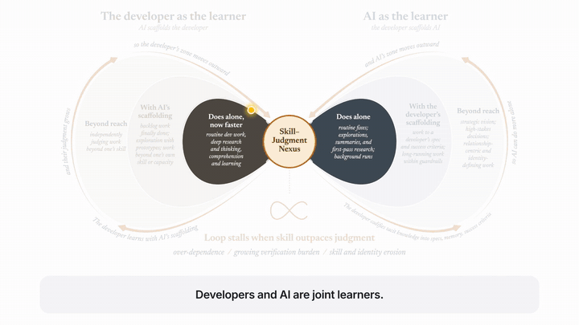
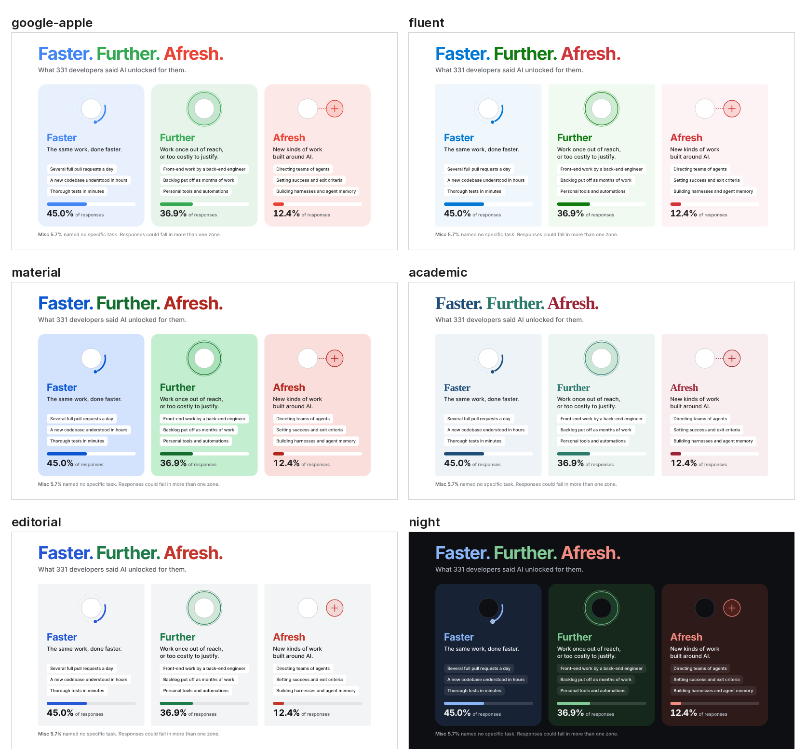

# paper-explainer

Turn a research paper into a short animated explainer video. Put in a paper, choose the script,
the voice and the design language, and Claude Code builds the motion graphics, paces them so every
slide can be read, and exports a 1080p MP4 with music and narration.



The example in `projects/to-boldly-go/` is the explainer for *"To Boldly Go Where No One Has Gone
Before": What Has AI Let Developers Unlock?* (Choudhuri, Butler, Bird, Badea, Houck, Sarma).
**Example output: [watch the narrated cut](https://rudrajit1729.github.io/paper-explainer/)** (`projects/to-boldly-go/output/To_Boldly_Go_voiceover.mp4`).

## The five choices

| Choose | Options | How |
|---|---|---|
| 1. The paper | any PDF | `explainer new my-paper --paper paper.pdf` extracts the text, captions and figures |
| 2. The script | what each scene says on screen and in the voice | edit `narration/<lang>.json` (or ask Claude Code to draft it from the paper) |
| 3. The voice | an AI voice, your cloned voice, your own recordings, or music only | `--engine ai`, `--engine clone`, `--engine recorded`, `--mode read` |
| 4. The language | English, Spanish, French, Italian, Portuguese, Hindi, Japanese, Chinese | `explainer add-language <project> es`, then `--lang es` |
| 5. The design language | six themes, shown below | `--theme academic` (or `"theme"` in project.json) |

Then: `explainer build projects/my-paper --mode voice`

## Design languages



| Theme | Look |
|---|---|
| `google-apple` | Google's four colors, Apple-style type, rounded tinted cards on white (default) |
| `fluent` | Microsoft palette, Segoe UI, small corners, light shadows |
| `material` | Google Material 3: Roboto Flex, tonal containers, large rounded shapes |
| `academic` | Serif headlines, muted inks, small corners: a conference-talk feel |
| `editorial` | Magazine-style: tight black headlines, toned-down accents, quiet grey cards |
| `night` | Dark keynote stage with bright accents; figures sit on a light panel |

A theme is one small CSS file of color, font and corner tokens in `explainer/web/themes/`. Copy one to
make your own (a lab or venue style), then `--theme yourname`.

## Voices

**AI voices.** Openly licensed (Kokoro, Apache-2.0), offline, free to publish. About 50 voices:

| Language | `lang` | Default | Others to try |
|---|---|---|---|
| English (US) | en-us | af_heart | af_bella, af_nicole, am_michael, am_fenrir |
| English (UK) | en-gb | bf_emma | bf_isabella, bm_george, bm_lewis |
| Spanish | es | ef_dora | em_alex |
| French | fr-fr | ff_siwis | |
| Italian | it | if_sara | im_nicola |
| Portuguese (BR) | pt-br | pf_dora | pm_alex |
| Hindi | hi | hf_alpha | hm_omega |
| Japanese | ja | jf_alpha | jm_kumo |
| Chinese | cmn | zf_xiaobei | zm_yunxi |

`explainer voices --lang en-gb` writes a sample of every voice so you can listen and pick.

**Your voice, recorded.** `explainer record projects/my-paper` opens a small recording studio in your
browser: each line of the script with Record, Play and Redo, a level meter, and keyboard shortcuts.
Files save straight into `recordings/en/`. Then build with `--engine recorded`.
Prefer your own setup? `explainer script` prints the lines; record one WAV per line, or one take with a
pause between lines and it is split for you.

**Your voice, cloned.** In the same recorder, the *Voice sample for cloning* tab records a 20 to 30
second sample. Then `--engine clone` speaks any script in your voice (Chatterbox, MIT; English;
`pip install -e ".[clone]"`). Use it only for voices you have permission to clone.

## Languages

```bash
explainer add-language projects/my-paper es --page    # narration/es.json + index.es.html to translate
explainer build projects/my-paper --mode voice --lang es
```

The narration file is translated line by line (Claude Code can do it); the optional page copy holds the
translated on-screen text. Timing adapts on its own, since each language's audio sets its own pace.

## Setup

```bash
git clone <this repo> && cd paper-explainer
python -m venv .venv && source .venv/bin/activate
pip install -e .                  # add ".[clone]" for voice cloning
playwright install chromium
brew install ffmpeg poppler       # Ubuntu: apt install ffmpeg poppler-utils
```

## Working with Claude Code

Open the repo in Claude Code. The skill in `.claude/skills/paper-explainer/` teaches it the whole
workflow, with guides for building, editing, motion graphics, voices and languages, and design. Ask
in plain words:

- "Make an explainer for projects/my-paper: the question, three findings, the main figure. About 80 seconds, narrated."
- "The figure scene is too fast. Slow it down and zoom into the method box when the voice mentions it."
- "Make a Spanish version in the academic theme with a male voice."
- "Use my recordings instead of the AI voice."

## Commands

| Command | Does |
|---|---|
| `explainer new NAME --paper PDF` | start a project, extract the paper |
| `explainer figure PDF --page N --out assets/fig.webp` | pull one figure out of the PDF |
| `explainer still PROJECT --at 5 12 20` | PNG frames to check a layout (seconds of animation) |
| `explainer build PROJECT --mode read\|voice [--preview]` | the whole pipeline to `output/` |
| `explainer build PROJECT --width 1280` | other sizes: 1280 = 720p, 1920 = 1080p (default), 3840 = 4K |
| `explainer clip PROJECT --name loop-figure` | cut a named clip |
| `explainer page PROJECT --standalone` | one shareable HTML file of the animation |
| `explainer record` / `voices` / `add-language` / `list` | voices, languages and themes |

## How it works

```
narration/<lang>.json ─► voice (AI, clone, recorded) ─► line durations ─┐
project.json timeline ──────────────────────────────────────────────────┼─► time map ─► page + engine + theme ─► frames ─► MP4
index.html scenes (animation time) ─────────────────────────────────────┘                    music cued to scenes ─► mix ─┘
```

Each page is authored once on animation time. The time map stretches each moment to fit its
narration or reading time, so one page works with any voice, speed or language.

## Licenses

Code: MIT. Inter font: SIL Open Font License (bundled). Kokoro: Apache-2.0. Chatterbox: MIT.
The music is generated in code for each video, so there is nothing to license.
